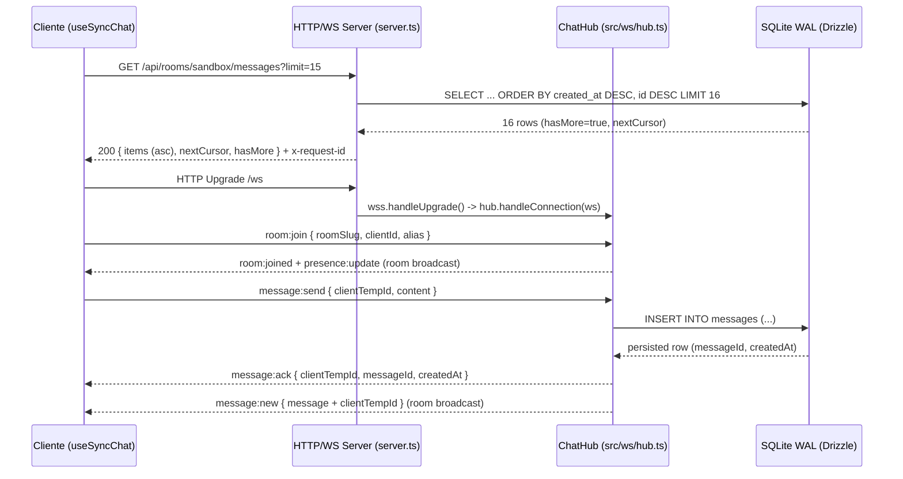

# PulseChat RT

[](./.github/workflows/ci.yml)


Plataforma standalone de mensajería bidireccional en tiempo real sobre un servidor unificado **Next.js 15 + `ws`** con contratos Zod discriminados, paginación por cursor compuesto `(createdAt, id)` y resiliencia de red con backoff exponencial.

- **Demo 1 clic**: [`/demo`](/demo) abre directamente la sala `#sandbox` con `@SyncBot` activo, vista espejo en vivo y envío optimista (`enviando` → `entregado ✓`).
- **Entrada desde landing**: [`/`](/) permite personalizar el alias por pestaña (`sessionStorage`) y entrar como invitado a `/chat`.
- **Observabilidad**: [`/api/health`](/api/health), [`/api/docs`](/api/docs) y [`/api/openapi.json`](/api/openapi.json) con errores RFC 7807 (`application/problem+json`) y `x-request-id`.

---

## Arquitectura y Flujo Tiempo Real



---

## Architecture Decision Records (ADRs)

### ADR-01: Paginación por Cursor Compuesto `(createdAt, id)` vs `OFFSET`
- **Contexto**: En salas activas llegan mensajes nuevos mientras el usuario hace scroll hacia arriba para cargar historial previo.
- **Decisión**: Cursor compuesto en base64url `{ createdAt, id }` con predicado `(created_at < cursorCreatedAt) OR (created_at = cursorCreatedAt AND id < cursorId)` sobre el índice `idx_messages_room_cursor(room_id, created_at, id)`.
- **Consecuencia**: Lecturas estables $O(\log N)$ sin duplicados ni saltos aunque entren mensajes en el mismo milisegundo.

### ADR-02: Reconexión con Exponential Backoff + Jitter + Heartbeat Activo
- **Contexto**: Reconexiones simultáneas tras un corte saturan el servidor (*thundering herd*), y pestañas cerradas abruptamente dejan miembros fantasma en presencia.
- **Decisión**: El cliente calcula `Math.min(1000 * 2 ** n, 30000) + jitter` (`src/lib/backoff.ts`); el servidor ejecuta `sweepStaleConnections()` cada 30s (`ping`/`pong`) podando sockets muertos y emitiendo `presence:update`.
- **Consecuencia**: Recuperación progresiva sin picos de carga y roster de presencia consistente.

### ADR-03: Contrato Zod Discriminado + Idempotencia por `clientTempId` + RFC 7807
- **Contexto**: Payloads WS malformados, reintentos de red o respuestas de error HTTP inconsistentes rompen el estado del cliente.
- **Decisión**: `ClientEventSchema` y `ServerEventSchema` (`z.discriminatedUnion`) validan el canal WS; `ChatHub` cachea `senderId:clientTempId` para re-emitir `message:ack` sin duplicar `INSERT`; las rutas `/api/*` devuelven `application/problem+json` con `x-request-id`.
- **Consecuencia**: Cero mensajes duplicados y diagnóstico trazable de punta a punta.

---

## Setup en 3 Pasos (`pnpm`)

```bash
pnpm install
pnpm db:migrate && pnpm db:seed
pnpm dev
```

Abre `http://localhost:3005` (o `http://localhost:3005/demo` para entrar en 1 clic).

---

## Trade-offs Honestos (100 → 100k usuarios)

1. **Estado de presencia y salas en memoria (`ChatHub` single-node) vs Pub/Sub distribuido**: A 100 usuarios, mantener `rooms`, `typingByRoom` y `ackCache` en memoria de un proceso `server.ts` da latencia sub-milisegundo sin infraestructura extra. Hacia 100k conexiones concurrentes, múltiples réplicas detrás de un balanceador no compartirían presencia ni broadcasts; habría que mover el fan-out a Redis Pub/Sub o NATS y externalizar `ackCache`.
2. **SQLite WAL embebido (`node:sqlite`) vs PostgreSQL dedicado**: A 100 usuarios, SQLite WAL resuelve lecturas concurrentes sin latencia de red y permite arrancar con cero servicios externos. Hacia 100k usuarios, el único escritor de SQLite se convierte en cuello de botella bajo ráfagas de `INSERT`; el proyecto ya incluye `docker-compose.yml` (`postgres:17-alpine`) y `src/db/schema.pg.ts` para migrar el almacenamiento transaccional a Postgres con *connection pooling*.
3. **Historial sin particionamiento ni retención fría**: A 100 usuarios, una única tabla `messages` con índice compuesto `(room_id, created_at, id)` responde en pocos milisegundos. Hacia 100k usuarios y decenas de millones de filas, el índice crece en RAM y las copias de seguridad se vuelven lentas; sería necesario particionar por rango temporal (`created_at`) y archivar mensajes antiguos a almacenamiento objeto.
